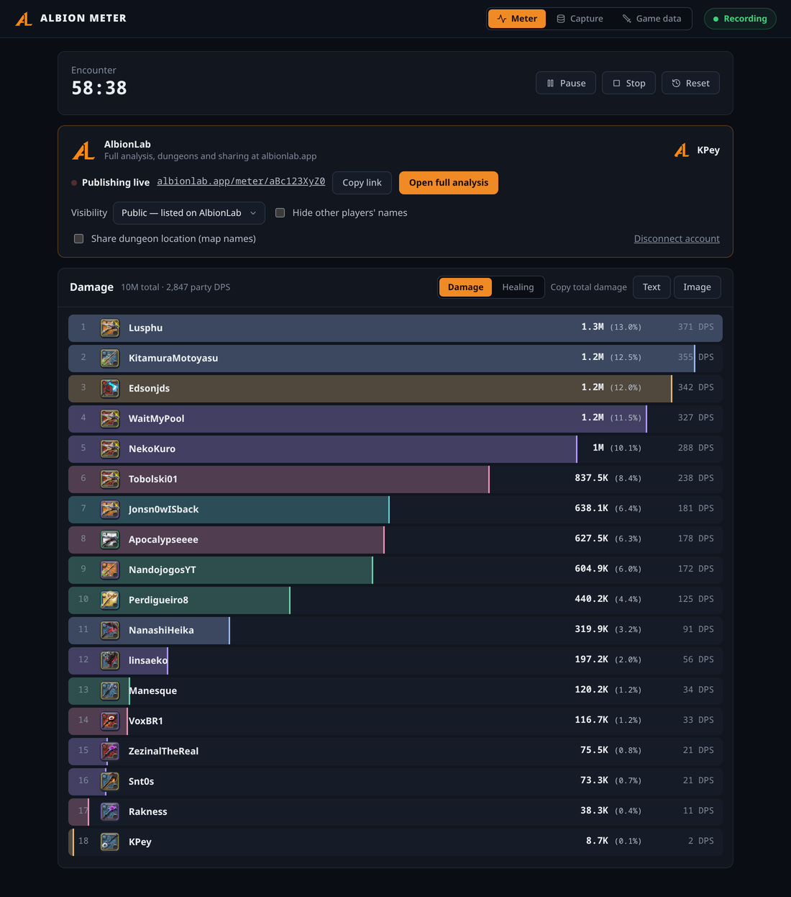
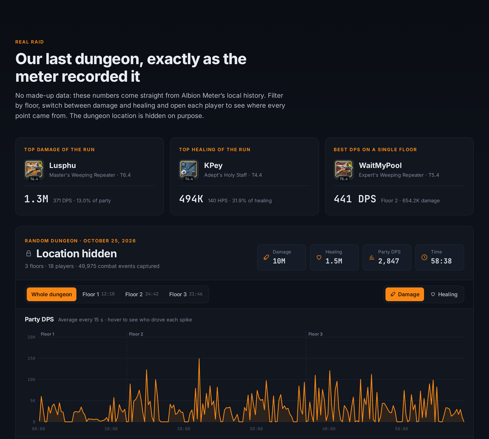
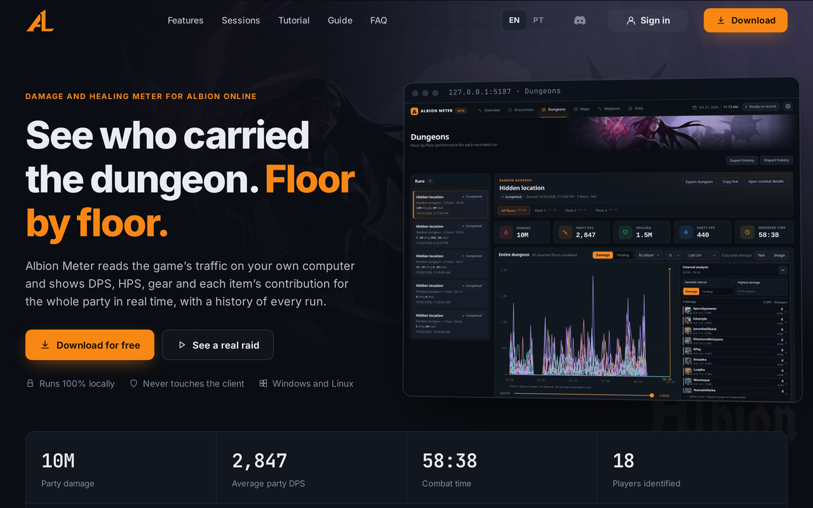
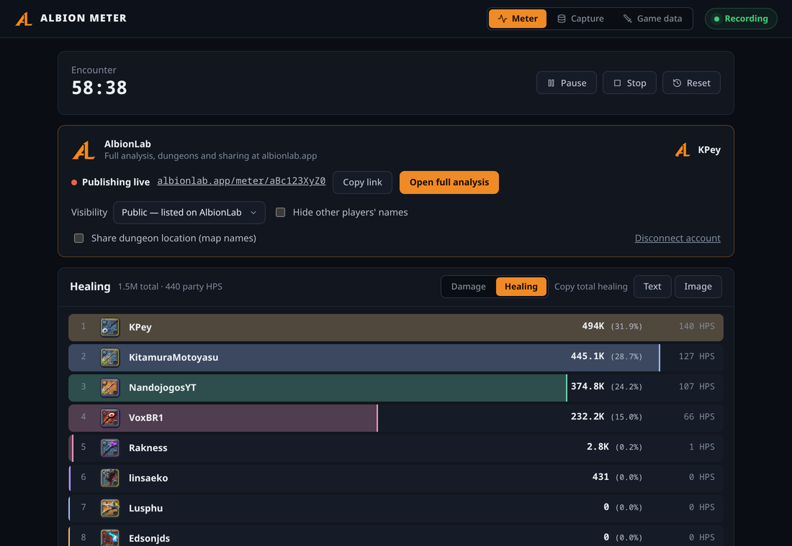
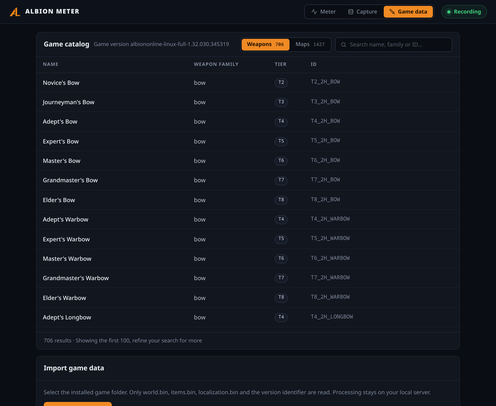
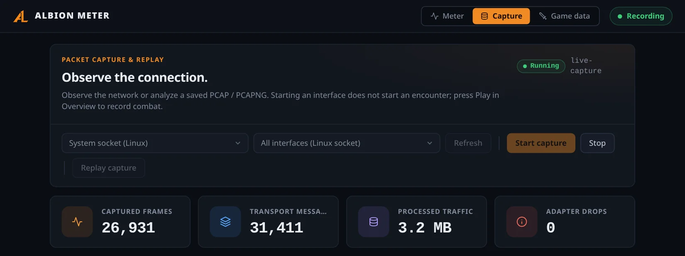

<p align="center">
  <a href="https://albionlab.app"></a>
</p>

<h1 align="center">Albion Meter</h1>

<p align="center">
  Free damage and healing meter for Albion Online, made by <a href="https://albionlab.app"><b>AlbionLab</b></a>.
</p>

<p align="center">
  <a href="https://albionlab.app">albionlab.app</a> ·
  <a href="https://albionlab.app/#download">Download</a> ·
  <a href="https://github.com/AlbionLab/AlbionMeter/releases/latest">Releases</a> ·
  <a href="https://albionlab.app/tutorial">Tutorial</a> ·
  <a href="https://albionlab.app/sessions">Public sessions</a> ·
  <a href="https://discord.gg/pAWsSxN5X2">Discord</a>
</p>

<p align="center">
  <a href="https://github.com/AlbionLab/AlbionMeter/releases/latest"></a>
  <a href="https://github.com/AlbionLab/AlbionMeter/releases"></a>
  <a href="https://github.com/AlbionLab/AlbionMeter/actions/workflows/build.yml"></a>
  <a href="https://discord.gg/pAWsSxN5X2"></a>
  <a href="https://albionlab.app"></a>
</p>

<p align="center">
  
</p>

Albion Meter runs on your own computer, observes the network traffic the game client already receives and shows live DPS and HPS for your whole party. It never reads the game's memory, never changes the client and never sends anything to the game servers. The interface is a local page served by the program at `http://127.0.0.1:5187`.

## AlbionLab

[**AlbionLab**](https://albionlab.app) is the home of Albion Meter. Connect the meter to your account once (sign in with Discord and approve the code the meter shows) and every record becomes a live session on the site, updated every second while you play:

- the full analysis: timeline, interval analysis, damage and healing by item and ability, each player's weapons and gear;
- every dungeon split by floor, with its own totals and progression;
- a link to share with your party, with visibility **Unlisted**, **Public** or **Private** and the option to hide the other players' names;
- public sessions from every player at [albionlab.app/sessions](https://albionlab.app/sessions).

The dungeon location is never shared unless you turn it on. Connecting is optional: the meter works fully offline.

<p align="center">
  
</p>

<p align="center">
  
</p>

## Features

- Live damage and healing bars for the party, with total, share and DPS/HPS for each player.
- **Play**, **Pause**, **Resume**, **Stop** and **Reset** of a record.
- Copy the ranking as chat text (`1. Name: 1305001(13,0%)|370,88 DPS`) or as an image.
- Capture through the system socket (no driver needed) or Npcap (Windows) / libpcap (Linux), on any network interface.
- Weapon, item and map names imported from your own game installation, so they always match your game version.
- Optional live publishing to [AlbionLab](https://albionlab.app).

| Healing | Game data |
| --- | --- |
|  |  |

<p align="center">
  
</p>

## What to install

Albion Meter uses the .NET installed on your computer, so install these once before opening it.

### Windows 10 / 11 (64-bit)

| | What | Download |
| --- | --- | --- |
| Required | .NET Runtime 10 (x64) | [dotnet-runtime-win-x64.exe](https://aka.ms/dotnet/10.0/dotnet-runtime-win-x64.exe) |
| Required | ASP.NET Core Runtime 10 (x64) | [aspnetcore-runtime-win-x64.exe](https://aka.ms/dotnet/10.0/aspnetcore-runtime-win-x64.exe) |
| Optional | Npcap — only for the **Npcap** capture method (the default **System socket** needs nothing) | [npcap.com](https://npcap.com/#download) |

All .NET 10 downloads: [dotnet.microsoft.com/download/dotnet/10.0](https://dotnet.microsoft.com/download/dotnet/10.0).

### Linux (64-bit)

| | What | Install |
| --- | --- | --- |
| Required | ASP.NET Core Runtime 10 | Ubuntu/Debian `sudo apt install aspnetcore-runtime-10.0` · Fedora `sudo dnf install aspnetcore-runtime-10.0` · Arch `sudo pacman -S aspnet-runtime` · [others](https://learn.microsoft.com/dotnet/core/install/linux) |
| Optional | libpcap — only for the **libpcap** capture method | `libpcap0.8` on Ubuntu/Debian, `libpcap` elsewhere |

Allow packet capture once after extracting: `sudo setcap cap_net_raw=ep ./AlbionMeter.Server`.

## Getting started

Download the latest version at [albionlab.app](https://albionlab.app/#download) and follow the [step-by-step tutorial](https://albionlab.app/tutorial). In short:

1. Install the requirements above, extract the download and open `AlbionMeter.Server` (accept the administrator prompt on Windows). Go to `http://127.0.0.1:5187`.
2. **Game data** → **Import game folder** → choose the folder that contains `Albion-Online_Data`.
3. **Capture** → keep **System socket**, pick your network interface → **Start capture**.
4. Optionally, **Connect account** in the AlbionLab card.
5. **Meter** → **Play**, then fight.

## Build from source

Requirements: .NET SDK 10 and Node.js 24.

```bash
npm ci --prefix web
node scripts/dev.mjs
```

The script builds the interface and the server, then starts the meter. On Linux it asks for the `cap_net_raw` capability after every build; on Windows the program asks for administrator rights.

Records are stored in `encounters.db` inside the user's local data folder (`AlbionMeter`). Use `--Storage:Directory=<path>` to choose another folder.

### Configuration

| Setting | Default | Meaning |
| --- | --- | --- |
| `Storage:Directory` | user data folder | Where records and settings are stored. |
| `Capture:AutoStart` | `false` | Start the last capture interface when the program opens. |
| `Capture:Debug` | `false` | Store raw packets (bounded) in the database for troubleshooting. |
| `AlbionLab:Url` | `https://albionlab.app` | Site used to publish sessions. |

Settings can be passed as arguments (`--Capture:AutoStart=true`) or environment variables (`Capture__AutoStart=true`).

### Tests

```bash
dotnet run --project tests/AlbionMeter.Tests
npm test --prefix web
```

### Packages

```bash
node scripts/publish.mjs win-x64
node scripts/publish.mjs linux-x64
```

Each command publishes a build that runs on the installed .NET 10 to `artifacts/<runtime>`, with a `LEIA-ME.txt` (English and Portuguese), and creates the matching `.zip` or `.tar.gz` package.

The version comes from `<Version>` in `Directory.Build.props`. Every push to `main` builds both packages and publishes them, with `SHA256SUMS.txt`, to the GitHub release `v<Version>`: a new version creates a new release, the same version replaces its files. Download the latest from [Releases](https://github.com/AlbionLab/AlbionMeter/releases/latest).

### Layout

- `src/AlbionMeter.Core` — packet capture, Photon decoding, combat observation and aggregation.
- `src/AlbionMeter.Server` — local server, record controls, history and AlbionLab publishing.
- `web` — the meter interface (React + TypeScript).
- `tests` — C# checks.
- `tools` — capture inspection and game data import command-line tools.
- `assets/game-data` — combat and map catalogs generated from the game data.
- `docs` — protocol and capture notes.

## Community

Questions, bugs and ideas: join the [AlbionLab Discord](https://discord.gg/pAWsSxN5X2).

Albion Meter is a community project and is not affiliated with or endorsed by Sandbox Interactive. Albion Online is a trademark of Sandbox Interactive GmbH.
