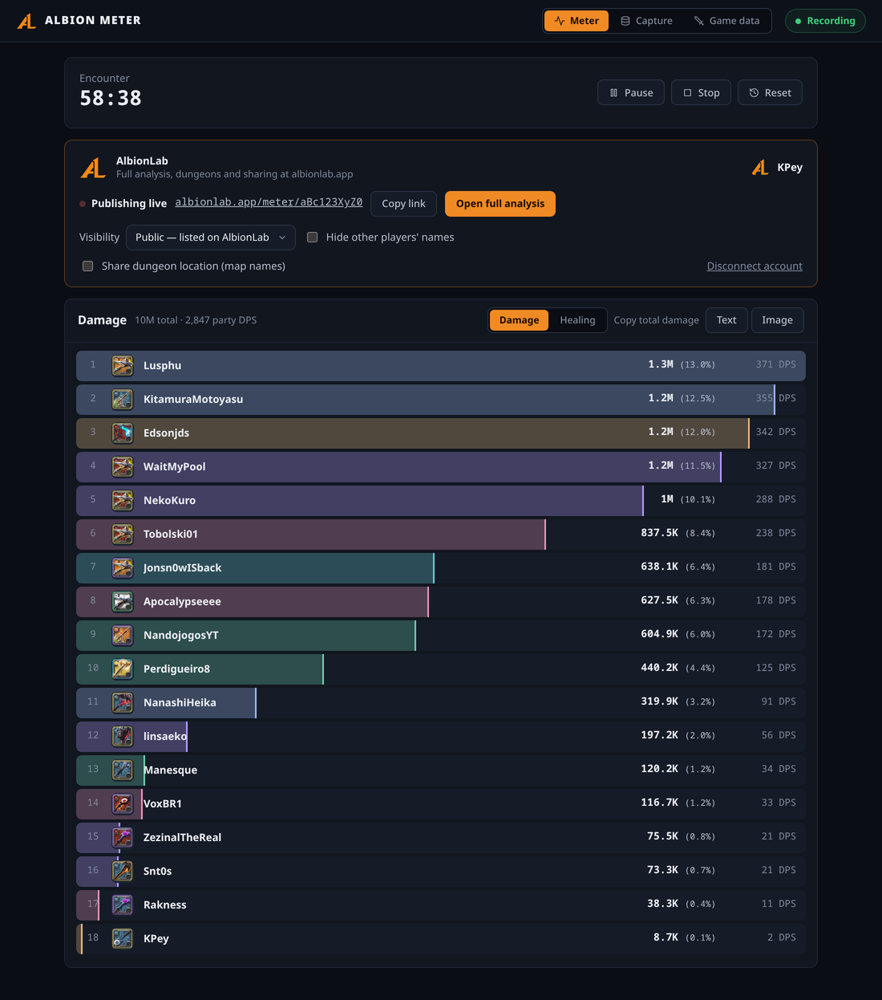
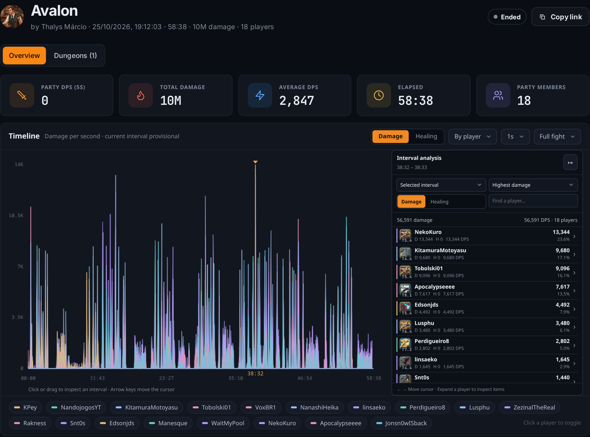
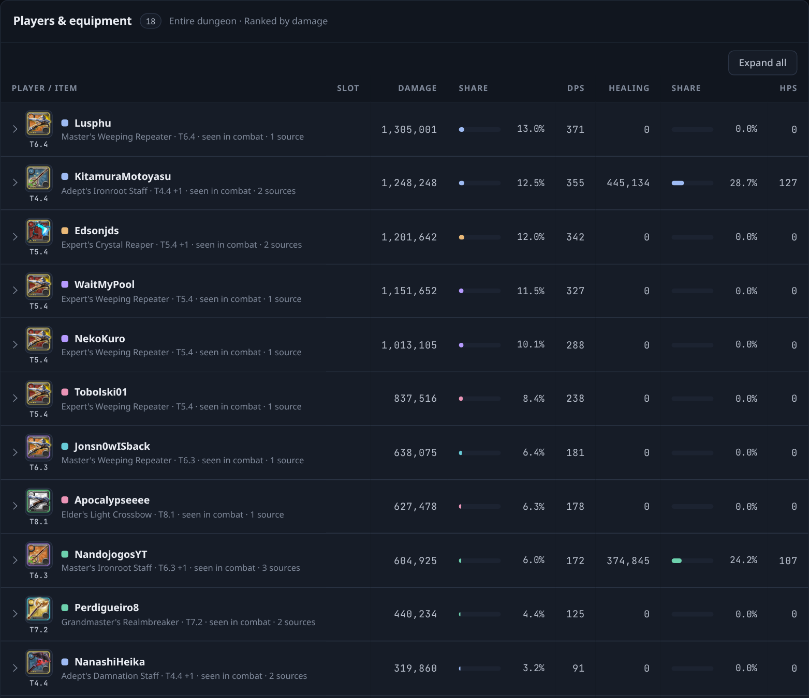
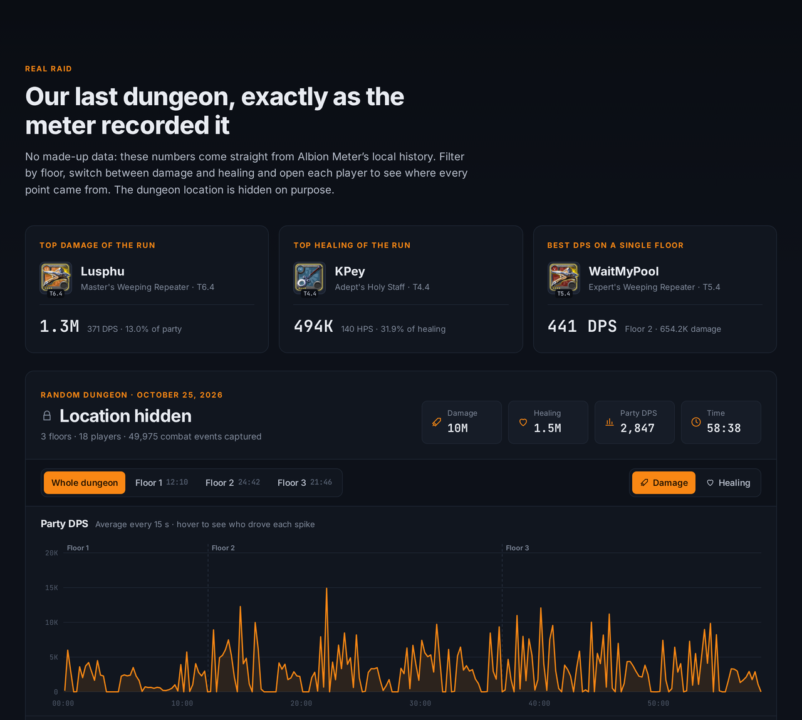
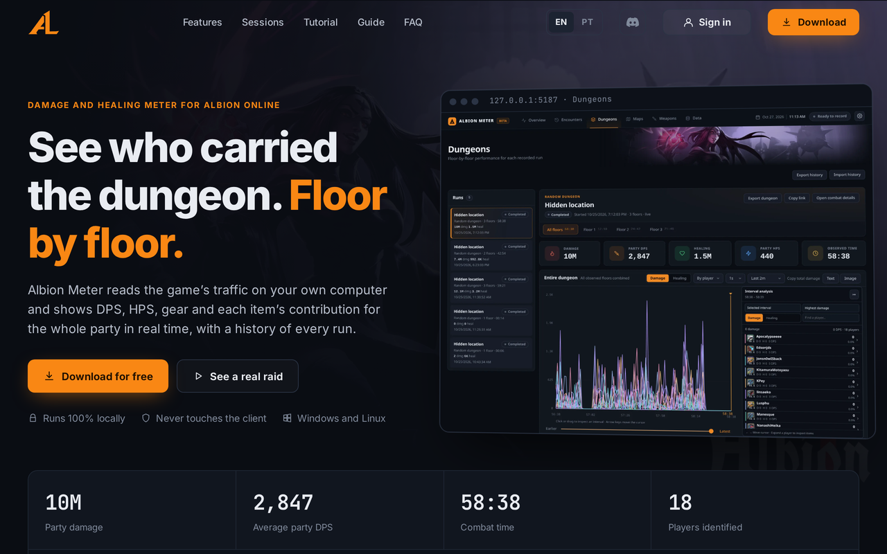
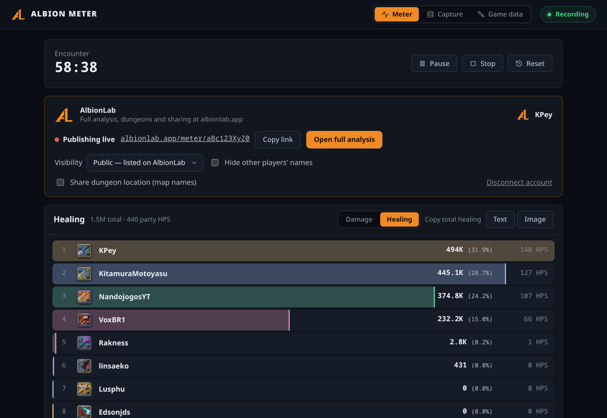
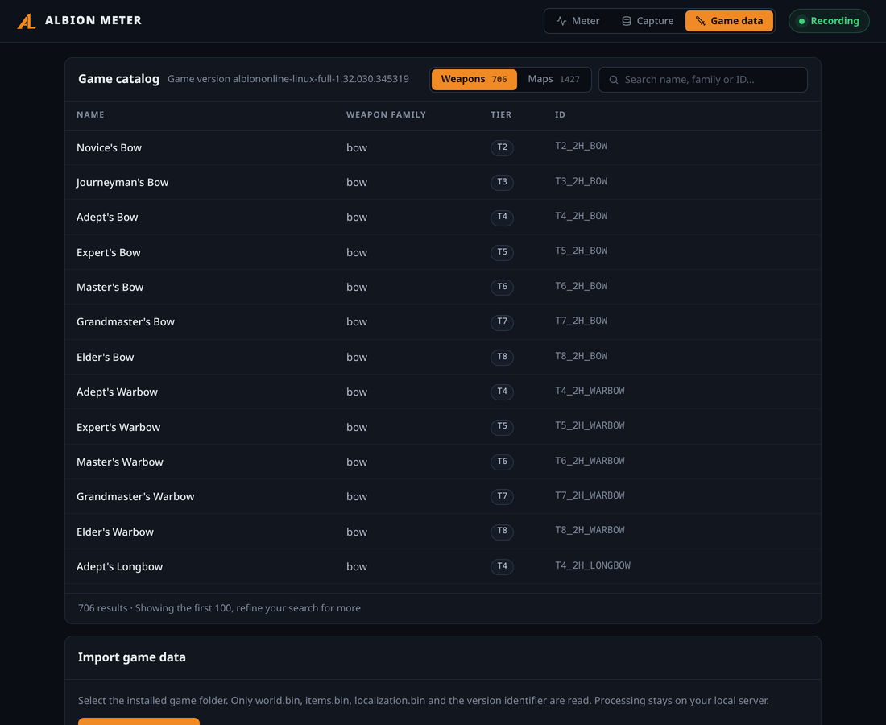
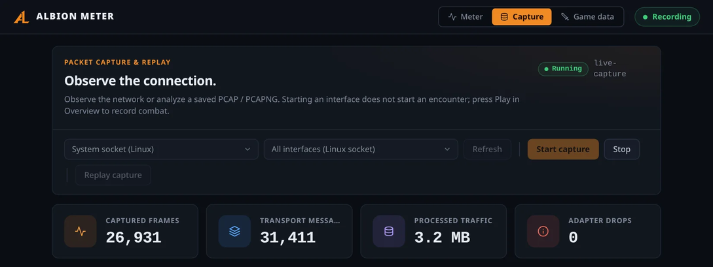

<p align="center">
  <a href="https://albionlab.app"></a>
</p>

<h1 align="center">Albion Meter</h1>

<p align="center">
  Free damage and healing meter for Albion Online, made by <a href="https://albionlab.app"><b>AlbionLab</b></a>.
</p>

<p align="center">
  <a href="https://albionlab.app">albionlab.app</a> ·
  <a href="https://albionlab.app/#download">Download</a> ·
  <a href="https://github.com/AlbionLab/AlbionMeter/releases/latest">Releases</a> ·
  <a href="https://albionlab.app/tutorial">Tutorial</a> ·
  <a href="https://albionlab.app/sessions">Public sessions</a> ·
  <a href="https://discord.gg/pAWsSxN5X2">Discord</a>
</p>

<p align="center">
  <a href="https://github.com/AlbionLab/AlbionMeter/releases/latest"></a>
  <a href="https://github.com/AlbionLab/AlbionMeter/releases"></a>
  <a href="https://github.com/AlbionLab/AlbionMeter/actions/workflows/rust.yml"></a>
  <a href="https://discord.gg/pAWsSxN5X2"></a>
  <a href="https://albionlab.app"></a>
</p>

<p align="center">
  
</p>

Albion Meter runs on your own computer, observes the network traffic the game client already receives and shows live DPS and HPS for your whole party. It never reads the game's memory, never changes the client and never sends anything to the game servers. The interface is a local page served by the program at `http://127.0.0.1:5187`.

## AlbionLab

[**AlbionLab**](https://albionlab.app) is the home of Albion Meter. Connect the meter to your account once (sign in with Discord and approve the code the meter shows) and every record becomes a live session on the site, updated every second while you play:

- the full analysis: timeline, interval analysis, damage and healing by item and ability, each player's weapons and gear;
- every dungeon split by floor, with its own totals and progression;
- a link to share with your party, with visibility **Unlisted**, **Public** or **Private** and the option to hide the other players' names;
- public sessions from every player at [albionlab.app/sessions](https://albionlab.app/sessions).

The dungeon location is never shared unless you turn it on. Connecting is optional: the meter works fully offline.

<p align="center">
  
</p>

<p align="center">
  
</p>

<p align="center">
  
</p>

<p align="center">
  
</p>

## Features

- Live damage and healing bars for the party, with total, share and DPS/HPS for each player.
- **Play**, **Pause**, **Resume**, **Stop** and **Reset** of a record.
- Copy the ranking as chat text (`1. Name: 1305001(13,0%)|370,88 DPS`) or as an image.
- Capture through the system socket (no driver needed) or Npcap (Windows) / libpcap (Linux), on any network interface.
- Weapon, item and map names imported from your own game installation, so they always match your game version.
- Optional live publishing to [AlbionLab](https://albionlab.app).

| Healing | Game data |
| --- | --- |
|  |  |

<p align="center">
  
</p>

## What to install

Nothing else: Albion Meter is a single native program (Rust, with a Slint interface), with no .NET, browser or
Electron behind it. It updates itself from the GitHub releases.

| | Windows 10 / 11 (64-bit) | Linux (64-bit) |
| --- | --- | --- |
| Download | `AlbionLab.AlbionMeter-rust-win-Setup.exe` (or the portable `.zip`) | `AlbionLab.AlbionMeter-rust-linux.AppImage` |
| Packet capture | asks for administrator once at start | asks for your password once (pkexec) to allow it |
| Optional | [Npcap](https://npcap.com/#download), only for the **Npcap** capture method (the default **System socket** needs nothing) | — |

Players on the previous (Electron) meter are moved to this one by its own update; history and settings stay where
they are.

## Getting started

Download the latest version at [albionlab.app](https://albionlab.app/#download) or from the
[`rust-latest` release](https://github.com/AlbionLab/AlbionMeter/releases/tag/rust-latest) and follow the
[step-by-step tutorial](https://albionlab.app/tutorial). In short:

1. Install and open Albion Meter (accept the administrator or password prompt).
2. **Game data** → **Import game folder** → choose the folder that contains `Albion-Online_Data`.
3. **Capture** → keep **System socket**, pick your network interface → **Start capture**.
4. Optionally, **Connect account** in the AlbionLab card.
5. **Meter** → **Play**, then fight.

## Build from source

Requirements: Rust (stable). On Linux also `libxkbcommon-dev libwayland-dev libfontconfig1-dev` (and `libpcap-dev` to
run the capture tests).

```bash
cd rust
cargo run --release -p meter-app
```

Records are stored in `encounters.db` inside the user's local data folder (`AlbionMeter`; or a `data` folder next to
the executable when there is one). Use `--Storage:Directory=<path>` to choose another folder.

### Configuration

| Setting | Default | Meaning |
| --- | --- | --- |
| `Storage:Directory` | user data folder | Where records and settings are stored. |
| `Capture:AutoStart` | `false` | Start the last capture interface when the program opens. |
| `Capture:Debug` | `false` | Store raw packets (bounded) in the database for troubleshooting. |
| `AlbionLab:Url` | `https://albionlab.app` | Site used to publish sessions. |

Settings are passed as arguments (`--Capture:AutoStart=true`).

### Tests

```bash
cd rust
cargo clippy --workspace --all-targets -- -D warnings
cargo test --workspace
```

### Releases

The version comes from `version` in `rust/Cargo.toml`. Every push to `rust` runs `.github/workflows/rust.yml` on Linux
and Windows (clippy, tests, the release build, a smoke test of the executable) and packages the meter with Velopack.
When every check passes, a push to `rust` publishes the release `rust-v<version>` (a new version creates it, the same version replaces
its files, with `SHA256SUMS.txt`) and refreshes `rust-latest`, the update feed installed meters read.

### Layout

- `rust/crates/meter-capture` — live capture (system sockets, Npcap) and pcap files.
- `rust/crates/meter-core` — Photon decoding, combat observation, aggregation, dungeon runs and catalogs.
- `rust/crates/meter-runtime` — the meter's threads: capture, the engine, saves, AlbionLab and icons.
- `rust/crates/meter-store` — history (SQLite), identities and history export/import.
- `rust/crates/meter-lab` — the AlbionLab account and live sessions.
- `rust/crates/meter-app` — the window and every screen (Slint), settings and updates.
- `assets/game-data` — combat and map catalogs generated from the game data.
- `docs` — protocol and capture notes.

## Community

Questions, bugs and ideas: join the [AlbionLab Discord](https://discord.gg/pAWsSxN5X2).

Albion Meter is a community project and is not affiliated with or endorsed by Sandbox Interactive. Albion Online is a trademark of Sandbox Interactive GmbH.
