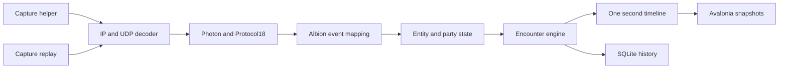

# Albion Meter: estudo técnico e arquitetura proposta

Data: 23/10/2026.

Atualização após decisão do usuário: a implementação iniciou com C# / ASP.NET Core, React / TypeScript, SignalR e Canvas. Avalonia permanece neste documento como alternativa inicialmente estudada. A primeira entrega usa demonstração, sem captura real. Consulte o README para execução e limites da validação.

## Escopo e evidência

O workspace estava vazio. A análise foi feita pelos arquivos acessíveis na web do repositório Triky313/AlbionOnline-StatisticsAnalysis. O clone pelo terminal falhou por resolução de DNS. As páginas consultadas têm datas de cache diferentes e não representam necessariamente um único commit. Portanto, este documento é um estudo do caminho de captura e combate, não uma auditoria integral ou uma validação executada do projeto.

Ainda faltam checkout fixado por SHA, leitura dos testes e módulos restantes, capturas reais do cliente atual e execução comparativa em Windows/Linux. Nenhum desempenho ou compatibilidade ao vivo foi medido.

Requisito de implementação: identificadores, arquivos, mensagens de código e testes em inglês; nenhum comentário no código. Documentação em português, separada do código.

## Funcionamento observado

O aplicativo principal usa C# e WPF, com alvo Windows. A solução separa abstrações, rede, parser Photon, Protocol18, diagnóstico, extração e testes. O aplicativo também contém módulos de mercado, crafting, loot e dungeons. Sua interface não é portável para Linux apenas trocando o target framework. [Projeto principal](https://github.com/Triky313/AlbionOnline-StatisticsAnalysis/blob/main/src/StatisticsAnalysisTool/StatisticsAnalysisTool.csproj).

O fluxo relevante é captura → IP/UDP → Photon → Protocol18 → evento Albion → entidades/party → combate → interface.

- `NetworkManager` seleciona captura por socket ou libpcap e registra handlers de combate e party. [Fonte](https://github.com/Triky313/AlbionOnline-StatisticsAnalysis/blob/main/src/StatisticsAnalysisTool/Network/NetworkManager.cs).
- `SocketsPacketProvider` abre raw sockets; no IPv4 usa `ReceiveAll`. Nesse caminho, fragmentos IPv4 são descartados. [Fonte](https://github.com/Triky313/AlbionOnline-StatisticsAnalysis/blob/main/src/StatisticsAnalysisTool/Network/PacketProviders/SocketsPacketProvider.cs).
- `LibpcapPacketProvider` filtra UDP nas portas 5055, 5056 e 5058, inclui fragmentos IPv4 no filtro e implementa remontagem. Possui seleção e recuperação de interfaces. Essas portas são configuração observada, não contrato permanente do jogo. [Fonte](https://github.com/Triky313/AlbionOnline-StatisticsAnalysis/blob/main/src/StatisticsAnalysisTool/Network/PacketProviders/LibpcapPacketProvider.cs).
- `PhotonParser` interpreta comandos, remonta fragmentos Photon e desserializa Protocol18. Pacotes marcados como criptografados são ignorados; não há decifragem nesse caminho. Fragmentação Photon e fragmentação IP são camadas distintas. [Fonte](https://github.com/Triky313/AlbionOnline-StatisticsAnalysis/blob/main/src/StatisticsAnalysisTool.PhotonPackageParser/PhotonParser.cs).
- `AlbionParser` obtém o código de evento pelo parâmetro 252 e de operação pelo 253. [Fonte](https://github.com/Triky313/AlbionOnline-StatisticsAnalysis/blob/main/src/StatisticsAnalysisTool.Network/AlbionParser.cs).
- `HealthUpdateEvent` mapeia alvo, timestamp, delta de vida, vida resultante, tipo/origem do efeito, causador e habilidade. `HealthUpdatesEvent` interpreta atualizações agrupadas. A semântica desses campos precisa ser validada com tráfego real antes de afirmar precisão de cura efetiva. [Evento individual](https://github.com/Triky313/AlbionOnline-StatisticsAnalysis/blob/main/src/StatisticsAnalysisTool/Network/Events/HealthUpdateEvent.cs), [evento agrupado](https://github.com/Triky313/AlbionOnline-StatisticsAnalysis/blob/main/src/StatisticsAnalysisTool/Network/Events/HealthUpdatesEvent.cs).
- `PartyJoinedEvent` associa GUIDs e nomes, e seu handler atualiza a party. Existem handlers separados de entrada, saída e dissolução. [Evento de party](https://github.com/Triky313/AlbionOnline-StatisticsAnalysis/blob/main/src/StatisticsAnalysisTool/Network/Events/PartyJoinedEvent.cs).

O projeto já possui DPS e HPS. `PlayerGameObject` usa totais e intervalos de combate individuais, chamando um utilitário com teto de 9999. Logo, não se deve apresentar DPS como funcionalidade ausente. [Modelo](https://github.com/Triky313/AlbionOnline-StatisticsAnalysis/blob/main/src/StatisticsAnalysisTool/Models/NetworkModel/PlayerGameObject.cs), [utilitário](https://github.com/Triky313/AlbionOnline-StatisticsAnalysis/blob/main/src/StatisticsAnalysisTool/Common/Utilities.cs).

`CombatEventTracker` separa encontros usando estado de combate da party, mudança de mapa e timeout em encontros implícitos. `CombatEvent` mantém contribuições com timestamp local, origem, alvo e habilidade. Isso já oferece material para análises temporais; não foi verificada toda a interface de gráficos existente. [Tracker](https://github.com/Triky313/AlbionOnline-StatisticsAnalysis/blob/main/src/StatisticsAnalysisTool/DamageMeter/CombatEventTracker.cs), [encontro](https://github.com/Triky313/AlbionOnline-StatisticsAnalysis/blob/main/src/StatisticsAnalysisTool/DamageMeter/CombatEvent.cs).

## Npcap: decisão

Npcap não é obrigatório para a captura do projeto. Sua alternativa Windows usa raw sockets, que exigem privilégios administrativos. Npcap também pode exigir elevação quando instalado com `admin_only`. [Microsoft](https://learn.microsoft.com/en-us/windows/win32/winsock/tcp-ip-raw-sockets-2), [Npcap](https://npcap.com/guide/npcap-users-guide.html).

Proposta:

| Plataforma | Captura principal | Alternativa |
| --- | --- | --- |
| Windows | Npcap por adaptador pcap | Raw socket, com limitações explícitas |
| Linux | libpcap | AF_PACKET direto, somente se houver necessidade demonstrada |
| Desenvolvimento | Replay PCAP/PCAPNG | Eventos normalizados de fixtures |

SharpPcap é um candidato para compartilhar a integração pcap entre os sistemas; não elimina as dependências nativas. Linux usa libpcap e pode capturar por AF_PACKET com `CAP_NET_RAW`. Não é necessário instalar Npcap no Linux. [SharpPcap](https://github.com/dotpcap/sharppcap), [Linux packet sockets](https://man7.org/linux/man-pages/man7/packet.7.html).

Recomendação de engenharia: manter a UI sem elevação e isolar captura privilegiada em um helper com IPC local restrito ao usuário. Capturar na interface que exponha o tráfego do jogo; Npcap não decifra o túnel de uma VPN. Suporte a VPN deve ser testado por interface e configuração.

## Stack recomendada

C# + .NET LTS estável + Avalonia + LiveCharts2 + SQLite. Fixar versões compatíveis após restore e build verificáveis, sem depender do SDK preview encontrado nesta máquina.

Avalonia atende Windows e Linux, com renderização própria e dependências gráficas do sistema. É aplicativo desktop sem Wine ou navegador obrigatório; não significa usar widgets nativos de cada sistema. LiveCharts2 possui integração Avalonia e exemplos de atualização em tempo real. [Avalonia](https://docs.avaloniaui.net/docs/supported-platforms), [LiveCharts2](https://livecharts.dev/docs/avalonia/latest/samples.general.realTime).

Minha avaliação: C# reduz a distância em relação ao protocolo de referência e permite uma UI rica com uma única linguagem principal. C++/Qt é uma alternativa forte, com maior custo de manutenção de memória e integração. Rust/Tauri permite interface web sofisticada, mas acrescenta frontend e diferenças entre WebView2 e WebKitGTK. MAUI não lista Linux como plataforma oficial. [Qt](https://doc.qt.io/qt-6/supported-platforms.html), [Tauri](https://v2.tauri.app/reference/webview-versions/), [MAUI](https://learn.microsoft.com/en-us/dotnet/maui/supported-platforms).

Publicar pacotes separados `win-x64` e `linux-x64`, testados em runners do respectivo sistema. Distribuição self-contained evita instalação manual do runtime .NET, mas mantém dependências de captura e sistema. Native AOT é uma opção adicional a validar com todas as bibliotecas; self-contained não significa AOT. [Native AOT](https://learn.microsoft.com/en-us/dotnet/core/deploying/native-aot/).

## Contrato das métricas propostas

| Métrica | Definição |
| --- | --- |
| Encounter DPS | Dano do jogador dividido pela duração comum do encontro |
| Rolling DPS | Dano na janela móvel de 1, 5 ou 10 segundos dividido pelo tempo observado da janela |
| Active DPS | Dano dividido por intervalos ativos definidos e exibidos separadamente |
| HPS | Equivalentes para cura, indicando se é observada ou efetiva |
| Damage share | Dano dividido pelo total do mesmo filtro, grupo e intervalo |
| Timeline | Soma em intervalos fixos de um segundo desde o início do encontro |

Exemplo: 60.000 de dano em 30 segundos produz 2.000 Encounter DPS. Se 18.000 ocorreram nos últimos 5 segundos, Rolling DPS de 5 segundos é 3.600. Os números respondem a perguntas diferentes.

Antes do primeiro segundo completo, mostrar aquecimento para a métrica de um segundo. O bucket atual é provisório. Duração zero não produz infinito. Valores reais não recebem teto artificial; abreviação visual não altera os dados.

Registrar segundos com zero durante observação válida. Falta de observação produz lacuna, não zero. Usar relógio monotônico para duração local, preservar timestamp do servidor quando interpretável e guardar a origem temporal. Eventos agrupados sem tempo individual conhecido não recebem timestamps fictícios.

Cura efetiva e overheal exigem significado confirmado do delta e estado de vida consistente. Quando disponíveis: cura efetiva limitada à vida faltante; overheal é o excesso. Com estado incompleto, mostrar cura observada e efetividade desconhecida. Não confundir regeneração, escudo, dano absorvido e cura.

## Arquitetura proposta

Projetos previstos: `AlbionMeter.Core`, `AlbionMeter.Protocol`, `AlbionMeter.Capture`, `AlbionMeter.CaptureHost`, `AlbionMeter.Storage`, `AlbionMeter.Desktop` e `AlbionMeter.Tests`.

O núcleo deve ser independente da UI. Uma fila limitada entrega eventos a um consumidor que atualiza o estado em ordem. Descartes por sobrecarga são contados e aparecem como captura incompleta. UI recebe snapshots, não cada pacote. Meta inicial: atualização visual a cada 100–250 ms, sujeita a benchmark.

Deduplicação deve considerar conexão, direção, canal, sequência de transporte e posição do evento. Nunca descartar dois hits apenas por terem valor, alvo e timestamp iguais. Limitar memória, tamanho de fragmentos, quantidade de remontagens e tempo de retenção.

Manter identidade da sessão/mapa separada do GUID do personagem: IDs de objetos podem mudar. Eventos sem identificação permanecem pendentes por prazo limitado. Ao trocar mapa ou reconectar, invalidar vínculos transitórios. Manter histórico temporal de membros da party para não reatribuir dano antigo após mudanças de grupo.

Persistir eventos normalizados e agregados por segundo. Buffers em memória têm retenção limitada; histórico longo usa redução de resolução somente para desenho, preservando os valores originais no armazenamento.

## Interface proposta

- Tema escuro em grafite, acento violeta, cura em verde e dano em âmbar, com contraste e estados acessíveis.
- Lista da party com nome, arma conhecida, DPS atual, DPS do encontro, HPS, total, participação e estado de observação.
- Gráfico central de um segundo por ponto, comparação de jogadores, tooltip, zoom e seleção de intervalo.
- Detalhes por jogador: habilidades identificadas, alvos, dano recebido, cura e mortes observadas.
- Histórico de encontros com duração, grupo, filtros e exportação de dados.
- Captura: interface selecionada, taxa de pacotes, perdas detectadas, falhas de parser e versão do mapeamento.

A identificação será por arma e família de arma, sem inferência de papéis. Membros fora da observação continuam na lista, mas seus valores não são extrapolados. Ter a lista da party não implica receber todo o combate de membros distantes.

## Sequência de implementação e critérios

1. Fixar checkout e mapear protocolo/eventos com capturas de referência.
2. Implementar motor determinístico e replay; validar totais, janelas e buckets.
3. Integrar captura Windows/Linux e comparar replay com captura ao vivo.
4. Construir UI, histórico e gráficos com dados do mesmo motor.
5. Empacotar e validar em ambos os sistemas, incluindo reconexão e VPN quando aplicável.

Testes essenciais: fragmentos fora de ordem; retransmissão; hits legítimos idênticos; limites de segundo; ausência de eventos; chegada tardia; cura parcial/excessiva; troca de party/mapa; captura iniciada no meio da luta; corrupção de pacote; limites de memória. A soma dos buckets deve reconciliar com o total do encontro para o mesmo filtro.

Benchmark deve medir CPU, memória, latência e perdas com replay documentado. Não afirmar que o aplicativo é mais rápido ou preciso sem comparação reproduzível. Validar execução gráfica no Windows e no Linux, além de compilar.

O repositório de referência identifica licença GPL-3.0. Qualquer reutilização de código deve preservar sua procedência e tratar a licença antes da distribuição. Este documento não copia implementações do projeto. [Repositório](https://github.com/Triky313/AlbionOnline-StatisticsAnalysis).
